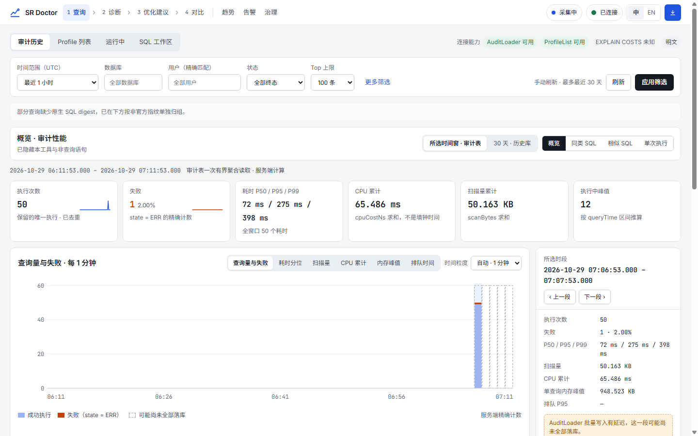
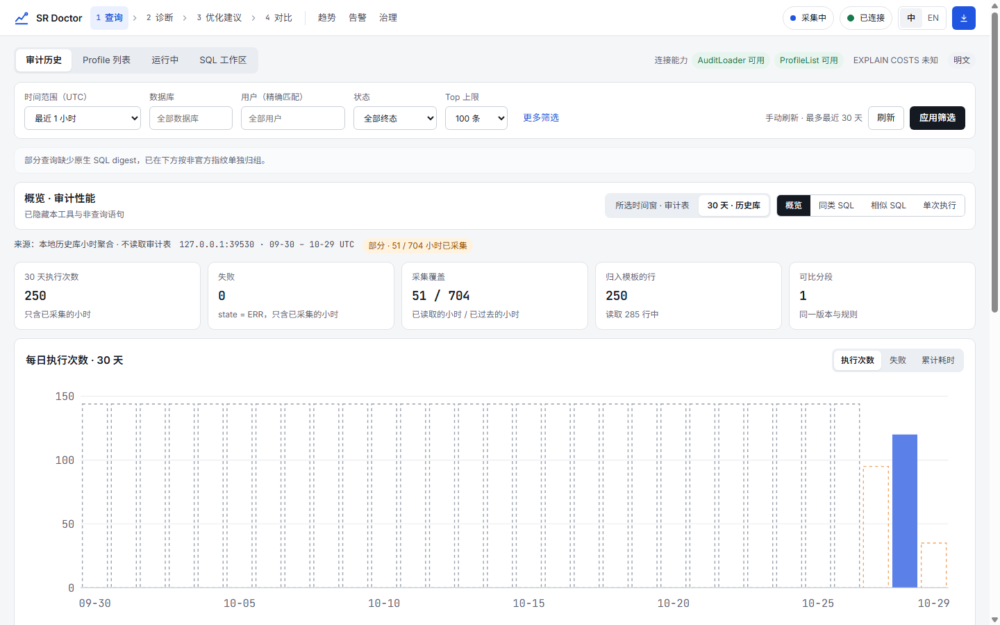
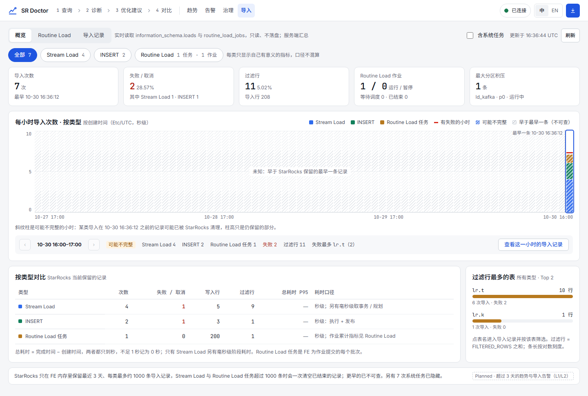
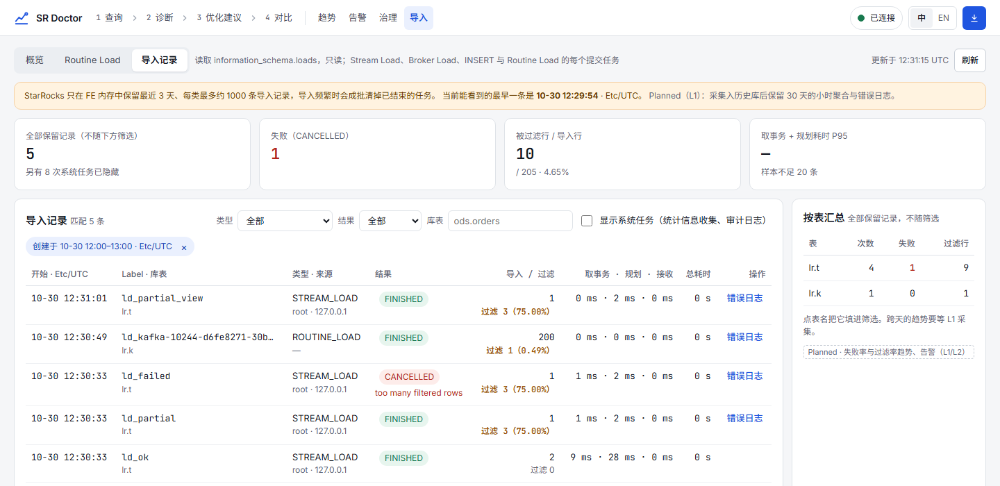
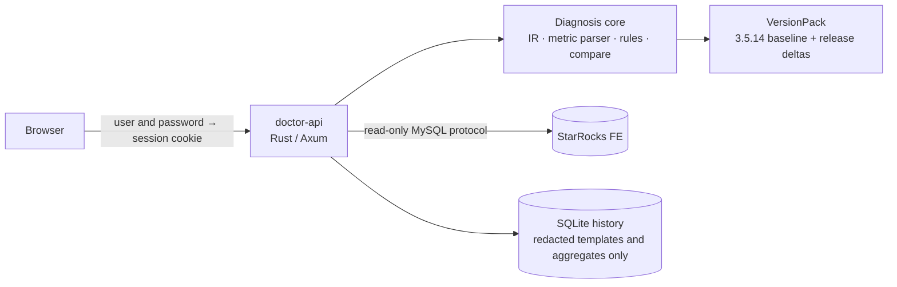

<div align="center">

# SR Doctor for StarRocks

[简体中文](README.md) · **English** · [繁體中文](README.zh-TW.md)

**A workbench for StarRocks query Profile diagnosis and SQL quality monitoring**

<sub>An independent community tool, not an official StarRocks product, and not affiliated with or endorsed by the StarRocks project. StarRocks is a trademark of its project owner; see [Trademarks](#trademarks).</sub>

See where a slow query spends its time and why, and keep finding the SQL that is getting slower.<br>
Every conclusion comes with evidence; when the evidence is not enough, it says so.

[](LICENSE)
[](docs/guide/faq.md)
[](docs/development/architecture.md)
[](docs/development/architecture.md)
[](#project-status)

[What's new](#whats-new) · [Quick start](#quick-start) · [Features](#features) · [Screenshots](#screenshots) · [Docs](#documentation) · [Security](SECURITY.md) · [Contributing](CONTRIBUTING.md) · [Changelog](CHANGELOG.md)


</div>

> The product UI is bilingual (English and Simplified Chinese). The detailed guides under `docs/` are written in Simplified Chinese.

## What's new

| Version | New |
|---|---|
| **v1.0.4** | Load history and load alerts: 30 days of load records kept; alerts when Routine Load pauses, lag grows or loads start failing more (on trial) |
| **v1.0.3** | Load performance for Stream Load, INSERT and Routine Load, each on its own |
| **v1.0.2** | Stream Load, Routine Load and INSERT monitoring: load counts, failures, durations, Routine Load lag, rejected rows and why |
| **v1.0.1** | SQL performance overview (trends of duration, scanned data, CPU and memory); alerts by email, Feishu, DingTalk and SMS |
| **v1.0.0** | SQL quality monitoring: similar SQL grouped, performance trends, alerts when SQL gets slower, issues tracked until fixed |

See the [changelog](CHANGELOG.md) for every change and [Releases](https://github.com/shenhui027-arch/sr-doctor/releases) to download.

## Why

A StarRocks Query Profile holds a great deal: dozens of fragments, hundreds of operators, thousands of counters. Reading a conclusion out of it usually takes experience, and the conclusion is hard to check. SR Doctor turns this into a workbench whose results are **evidence-based and verifiable**:

- **Official semantics only**: metric units, operator merging and time share follow the official StarRocks source code, not guesses. StarRocks 3.1 and later is supported with one 3.5.14 baseline rule set plus per-release deltas found by auditing the official source.
- **Every conclusion is traceable**: findings carry evidence, confidence, limitations and the location in the raw Profile; the execution structure only draws relations it can prove.
- **Missing means missing**: missing data, parse failures, too few samples and incomparable versions are labelled as such, never turned into `0` or a forced conclusion.
- **Read-only by default, easy to deploy**: one command on a Linux server, and the team uses it from a browser; connect to StarRocks with IP, port, user and password.

## Quick start

On a Linux server with Docker and Compose:

```bash
git clone https://github.com/shenhui027-arch/sr-doctor.git
cd sr-doctor
docker compose up -d --build
```

Then:

1. Open `http://<server>:8000` in a browser and sign in as `admin` / `123456` (to change the password, put `DOCTOR_ADMIN_PASSWORD=<new>` in `.env` and run `docker compose up -d` again);
2. Click **Connect** and enter the StarRocks FE IP, port (default `9030`), user and password;
3. Pick an audit record or a Profile under **Queries** to see its diagnosis.

No cluster? **Import a Profile** on the first page to analyze a JSON or text Profile offline.

> For status, backup and upgrade commands, use `./deploy.sh`, which wraps the same `compose.yaml`. No internet access on the server? Run `./deploy.sh package` on a connected machine, copy the offline package to the server, extract it and run `./deploy.sh`. Other ways to run it (local process, SSH tunnel, HTTPS reverse proxy) are in the [deployment guide (Chinese)](docs/guide/deployment.md).

## Features

### Profile diagnosis

| Capability | What it does |
|---|---|
| Import and fetch | Import JSON/text Profiles offline, or connect read-only and fetch them from the audit history, the Profile list or running queries |
| Real execution structure | Fragment and operator topology; explicit, verified-derived and partial relations are kept apart and no edge is invented |
| Findings | Ordered by severity, each with evidence, confidence, limitations and a recommendation; no health score |
| Operators and metrics | Every counter goes through one typed metric parser; the raw Profile and its provenance are always one click away |
| Recommendations | Each links its finding, operator and source evidence, with investigation steps and a verification plan; SQL is never changed automatically |
| Before / after | Measured changes as intervals; a zero baseline gives only the absolute change; differing semantics are marked "not comparable" |
| SQL workspace | A fixed `EXPLAIN COSTS` topology; with "Runtime Top" explicitly enabled, one restricted `SELECT`/`WITH` can be run and its Profile analyzed |
| Export | Redacted analysis and comparison reports |

### SQL quality monitoring (v1.0)

| Capability | What it does |
|---|---|
| Fingerprints and clusters | The official digest when present, otherwise a normalized fingerprint marked "unofficial"; similar-SQL clusters show why they were merged and can be split |
| History and collection | Bounded incremental reads of the audit log while connected: one connection, a fixed period, row and timeout limits; over budget it skips and marks "partial" |
| Trends and regressions | Hourly medians with a baseline band; too few samples, version or rule changes and collection gaps are labelled, never interpolated |
| In-app alerts | Raised only by regression checks, with severity, confidence and evidence completeness shown separately |
| Governance queue | New → triaged → in progress → pending verification → closed; an item closes only when a before/after comparison confirms the improvement |

### Audit overview (v1.0.1)

| Capability | What it does |
|---|---|
| Selected window | The default view of Audit history: one bounded aggregation read of the audit table draws executions and failures, duration P50/P95/P99, scanned bytes, CPU, peak memory and queue time over time; pick a bucket to drill into its executions or repeated SQL. Also a duration histogram, failures by errorCode, and the workload by user, database, resource group and catalog. Percentiles use StarRocks `PERCENTILE_DISC`, and the page states how it picks a value |
| 30 days · history | Daily bars, a weekday × hour heatmap and this week against last week from the local hourly aggregates; only additive totals are drawn and no percentile is synthesized; days that were not collected stay empty, and nothing is compared across a version or rule change |

### Alert notifications (v1.0.1)

| Capability | What it does |
|---|---|
| Channels | Besides the in-app badge, new alerts go to email (SMTP), Feishu and DingTalk custom bots, Alibaba Cloud SMS and Tencent Cloud SMS |
| Several targets | Each channel takes several mailboxes, group bots or phone numbers, each switched on, tested and given its own lowest severity; one list shows every target |
| Write-only secrets | Passwords, webhooks, signing secrets and AccessKey secrets are sealed with AES-256-GCM in the local history store; the page and API only say "saved" |
| Delivery log | Result, retries and error category of every send; 10-second timeout, network failures retry after 1/5/30 minutes; SMS has an hourly limit |
| Content | Only the cluster, template fingerprint, severity, confidence and median change; no SQL literals, Profiles or passwords; Feishu and DingTalk only on their official hosts |

### Loads (v1.0.4)

| Capability | What it does |
|---|---|
| Overview | Switch between All / Stream Load / INSERT / Routine Load, each with only its own measures: data received, the three millisecond phases and sources for Stream Load; scanned data, the total-time distribution and the slowest loads for INSERT; job health, outcomes, throughput, task times and partition lag for Routine Load; the All view stacks hourly loads by type and compares the types. Click a chart for its records or job. The audit overview gets a load card too |
| Routine Load | Job state, per-partition progress and lag, rates, error rows and why a job paused; read-only, no pause or resume |
| Load records | Stream Load, Broker Load, INSERT and Routine Load task results, filtered rows, begin-transaction / plan / receive-data times in ms, source user and IP, per-table totals |
| Error log | Open a load to see the rows StarRocks rejected and why (the ErrorURL text, read through read-only SQL), grouped by reason; says so when the BE has already cleaned it up |
| History | The background collector stores finished loads per hour in the local history store: 30 days of daily counts, failure and filter rates and per-table totals; Routine Load job states, increases and lag; a copy of the error log of each load with filtered rows (plain text, 30 days, 50 MB in all). Uncollected spans are not filled in; hours StarRocks cleared first are marked partial |
| Load alerts | The Alerts page switches between "SQL regressions" and "Loads". Five trial rules are evaluated on the stored load history after every collection: Routine Load paused, stopped or cancelled, lag rising, failure rate jump and filter rate jump; too few samples, incomplete collection or a version or rule change decides nothing. Pause reasons stay in the app; notifications carry facts only |
| Limits | Overview, Routine Load and load records read `information_schema` live; StarRocks keeps only the last 3 days / about 1000 records; complete from 3.3 |

## Screenshots

<table>
  <tr>
    <td width="50%"><br><sub><b>First run</b>: import a Profile offline or connect read-only</sub></td>
    <td width="50%"><br><sub><b>Recommendations</b>: linked to findings, operators and source evidence</sub></td>
  </tr>
  <tr>
    <td><br><sub><b>Before / after</b>: measured intervals, finding changes and incomparable items</sub></td>
    <td><br><sub><b>Repeated SQL</b>: grouped by the official digest, with frequency and cumulative cost</sub></td>
  </tr>
  <tr>
    <td><br><sub><b>Audit overview</b>: trends over time, the selected bucket and window totals</sub></td>
    <td><br><sub><b>30-day load</b>: daily bars, collection coverage and comparable segments</sub></td>
  </tr>
  <tr>
    <td colspan="2"><br><sub><b>Execution structure</b>: fragment containers, operator category colours, nodes with findings outlined in red, upstream output rows and join probe/build inputs on the edges</sub></td>
  </tr>
  <tr>
    <td><br><sub><b>Template trends</b>: hourly medians and the baseline band</sub></td>
    <td><br><sub><b>Collection and history</b>: watermarks, read budget and coverage</sub></td>
  </tr>
  <tr>
    <td><br><sub><b>Alerts</b>: regression checks and their evidence</sub></td>
    <td><br><sub><b>Governance queue</b>: pin a baseline, close after verification</sub></td>
  </tr>
  <tr>
    <td><br><sub><b>Load overview</b> (v1.0.3): switch between Stream Load / INSERT / Routine Load, each with only its own measures; the All view stacks hourly loads by type and compares the types; hours before the oldest record are marked unknown</sub></td>
    <td><br><sub><b>Load records</b> (v1.0.2): opened from an hour in the overview, with phase times in ms, filtered rows and the error log</sub></td>
  </tr>
</table>

<sub>All screenshots are of the running product (UI in Chinese). Offline pages use the official 3.5.14 corpus in this repository; connected and monitoring pages use a local Docker StarRocks 3.5.14 fixture with a real test workload plus a stretch of history labelled as synthetic. None of it is production data.</sub>

## How it works



One process serves both the pages and the API; the frontend renders what the backend returns and never parses Profiles or recomputes metrics itself. See the [architecture overview (Chinese)](docs/development/architecture.md).

## Security and boundaries

- **Read-only connections**: no DDL/DML, multi-statements or `EXPLAIN ANALYZE`; SQL and settings are never changed automatically.
- **Credentials never touch disk**: StarRocks passwords live only in a short-lived in-memory session; they are never returned to the page or logged.
- **Redacted history**: only redacted templates, fingerprints and hourly aggregates, kept 30 days by default; no SQL literals, raw Profiles or passwords. The one exception is load error logs: the rows StarRocks rejected are kept in plain text by agreement (30 days, 50 MB in all), shown only when opened, and never put in logs, notifications or exports.
- **Access control**: a server deployment asks for a login, `admin` / `123456` by default and changeable in `.env`; writes also require same-origin and a CSRF token. All users share one account; there are no roles. Everyone knows the default password, so change it before exposing the server to a network you do not fully trust.
- **Transport**: plaintext by default to any reachable host, clearly labelled in the UI; TLS verify-full when the FE has SSL enabled.

The full security model and how to report a vulnerability are in [SECURITY.md](SECURITY.md).

## Supported StarRocks versions

Every line from **3.1** on is supported; the audit currently reaches 4.1. There is one rule set (the 3.5.14 baseline); other releases apply deltas found by auditing the official source release by release, and every line has been checked node by node against the official `ANALYZE PROFILE` on official images.

| Line | Status | Notes |
|---|---|---|
| 3.1 (3.1.0–3.1.17) | ✅ Supported | No Plan Advisor; the early spellings of 3.1.0–3.1.3 (counter format, unnumbered operators, output-rows recipe, missing query counters) are handled per the official source |
| 3.2 (3.2.0–3.2.16) | ✅ Supported | No Plan Advisor; 3.2.9 and earlier lack some query-level memory counters, shown as unavailable |
| 3.3 (3.3.0–3.3.22) | ✅ Supported | No Plan Advisor; an official merge defect in 3.3.0–3.3.11 computes maxima wrongly, so `__MAX_OF_` counters are not used as evidence there |
| 3.4 (3.4.0–3.4.10) | ✅ Supported | 3.4.0–3.4.1 have the same merge defect |
| 3.5 (3.5.0–3.5.21) | ✅ Supported | The 3.5.14 semantic baseline is on this line |
| 4.0 (4.0.0–4.0.17) | ✅ Supported | 4.0.17 takes query CPU and spill as the max per BE, then sums over BEs; handled |
| 4.1 (4.1.0–4.1.7) | ✅ Supported | Same as above (4.1.7) |
| New lines (4.2 on) and newer patches of supported lines | ⏳ After audit | Registered only after a source audit and an official-image smoke test; until then no nearby rules are borrowed and metrics are unavailable |
| 2.5, 3.0 | ❌ Not supported | See below |

**Why 2.5 and 3.0 are no longer supported:**

- **No official semantics to rely on**: the official operator time-share and output-rows algorithm (`ExplainAnalyzer`) arrives in 3.1. 2.5 and 3.0 Profiles also print no topology and carry no final-snapshot or merge markers. An execution graph, time share or health conclusion would have to be derived by us, with no official `ANALYZE PROFILE` to check it against. That breaks this project's rule: official semantics only, and missing means missing.
- **Long out of maintenance**: the last 3.0 patch is 3.0.9 (2023-12) and the last 2.5 patch is 2.5.22 (2024-06).
- **Cost out of proportion**: their text Profile layout (execution section header, query state spelling, unnumbered operators) differs from 3.1 on, which needs a separate parser branch for readings that cannot reach a conclusion.

Connecting to 2.5 or 3.0 shows "unsupported version" and reads no audit or Profile; an imported Profile from them is marked as an unsupported version, with every metric unavailable and no numeric conclusion. 3.1–3.4 are no longer maintained by StarRocks either, but they carry the official semantics and have been verified node by node, so they stay supported.

## Project status

| | Status |
|---|---|
| Latest release | **v1.0.4** (2026-10-31), see [Releases](https://github.com/shenhui027-arch/sr-doctor/releases). Servers are deployed with Docker; there is no installer |
| v1.0.0 | SQL quality monitoring stages A–D developed and accepted locally; all 19 issues from the project-wide audit fixed |
| v1.0.1 | Adds the audit overview (window performance charts and the 30-day load view) and multi-channel alert notifications; local CI and the official 3.5.14 E2E pass (email checked against a local SMTP receiver); real Feishu, DingTalk, Alibaba Cloud and Tencent Cloud delivery is **pending verification** |
| v1.0.2 | Adds the load workspace (overview, Routine Load, load records, error logs) and a load card in the audit overview, and fixes connecting to 3.1–3.3; the official 3.5.14 + Kafka E2E and load smoke tests on official 3.2–4.1 images pass |
| v1.0.3 | Splits the load overview into Stream Load / INSERT / Routine Load, each with only its own measures, and fixes Routine Load task phase times counted as 0; the official 3.5.14 + Kafka E2E passes and the official 3.1.17 image was checked in a browser |
| v1.0.4 | Stores loads in the local history store (30-day statistics, Routine Load job history, copies of error logs) and adds five trial load alerts; history store schema 7; the official 3.5.14 + AuditLoader + Kafka E2E passes |
| Local verification | Local CI passes; on fixed-digest official `starrocks/*:3.5.14` Docker fixtures, the fingerprint, collection, trends, alerts and governance, multi-BE, release-audit and TLS verify-full E2E tests pass |
| Production acceptance | **Pending**: the G1 read-only production pilot and G2 real-workload calibration have not been done, so it is not claimed to be production-safe; remote clusters are not collected by default and alert thresholds are marked as on trial |
| Supported versions | StarRocks **3.1 and later** (audited 3.1–4.1); 2.5 and 3.0 are not supported. See [Supported StarRocks versions](#supported-starrocks-versions) |

Later plans (multiple users and permissions, high availability) are outside the current scope.

## Documentation

The guides are in Simplified Chinese.

| I want to… | Read |
|---|---|
| Run it in five minutes | [Quick start](docs/guide/quick-start.md) |
| Deploy to a server, install offline, set up HTTPS | [Deployment](docs/guide/deployment.md) |
| Look up a setting | [Configuration](docs/guide/configuration.md) |
| Learn each page | [User guide](docs/guide/user-guide.md) |
| Solve a common problem | [FAQ](docs/guide/faq.md) |
| Develop and run the tests | [Development guide](docs/development/README.md) · [Contributing](CONTRIBUTING.md) |
| Read the design specs and contracts | [Documentation hub](docs/README.md) |

## Contributing

Issues and pull requests are welcome. Please read [CONTRIBUTING.md](CONTRIBUTING.md) first: the repository uses a local CI script (`scripts/ci/local-ci.ps1`) that must pass before merging, and changes to the parser, the execution structure or security boundaries need tests.

## Acknowledgements and clean-room note

The information architecture of the UI drew on the visible interaction habits of community Profile tools (see [product scope and baselines (Chinese)](docs/00-product-scope-and-baselines.md#22-社区工具只观察可见行为)). The code, parser, rules and thresholds are our own, with the official StarRocks 3.5.14 source and documentation as the semantic reference; the repository contains no source, screenshots or brand assets of reference projects. StarRocks is a trademark of its respective owner.

## Trademarks

StarRocks is a trademark of the StarRocks project, a Series of LF Projects, LLC; see [lfprojects.org/policies](https://lfprojects.org/policies/). SR Doctor is an independent, unofficial tool and is not affiliated with, sponsored or endorsed by the StarRocks project, LF Projects, LLC or the Linux Foundation. "for StarRocks" in its name only says which database it works with.

## License

[Apache License 2.0](LICENSE); see also [NOTICE](NOTICE).
