<div align="center">

# SR Doctor for StarRocks

**简体中文** · [English](README.en.md) · [繁體中文](README.zh-TW.md)

**StarRocks 查询 Profile 诊断与 SQL 质量监控工作台**

<sub>独立的社区工具，非 StarRocks 官方产品，与 StarRocks 项目无隶属或背书关系。StarRocks 是其项目所有者的商标，详见[商标](#商标)。</sub>

看清一条慢 SQL 的时间花在哪里、为什么，并持续发现哪些 SQL 在变慢。<br>
每一个结论都附证据；证据不够时，它会直说“不知道”。

[](LICENSE)
[](docs/guide/faq.md)
[](docs/development/architecture.md)
[](docs/development/architecture.md)
[](#项目状态)

[快速开始](#快速开始) · [功能](#功能) · [截图](#截图) · [文档](#文档) · [安全](SECURITY.md) · [参与开发](CONTRIBUTING.md) · [更新日志](CHANGELOG.md)

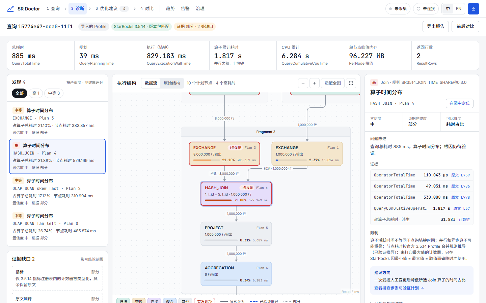

</div>

## 为什么用它

StarRocks 的 Query Profile 信息量很大：几十个 Fragment、上百个算子、成千个指标。要从里面读出结论，往往得靠经验，读出来的结论也很难复核。本项目把这件事做成一个**有证据、可复核**的工作台：

- **只按官方语义解析**：指标单位、算子归并、时间占比，都以 StarRocks 官方源码为准，不靠猜。支持 3.1 及以后的版本：一套 3.5.14 基线规则，加上逐版本审计官方源码得出的差异。
- **每个结论都能追溯**：发现项附带证据、置信度、限制说明和原始 Profile 位置；执行结构只画能证明的边。
- **缺失就说缺失**：数据缺失、解析失败、样本不足、版本不可比，都会如实标出，不当成 `0`，也不硬给结论。
- **默认只读，部署简单**：一条命令部署到 Linux 服务器，团队成员用浏览器访问；连接 StarRocks 只填 IP、端口、用户名和口令。

## 快速开始

在一台装有 Docker 与 Compose 的 Linux 服务器上：

```bash
git clone https://github.com/shenhui027-arch/sr-doctor.git
cd sr-doctor
docker compose up -d --build
docker compose exec doctor cat /etc/sr-doctor/access-token   # 首次启动自动生成的访问令牌
```

然后：

1. 浏览器打开 `http://<服务器地址>:8000`，输入访问令牌；
2. 点右上角 **连接**，填写 StarRocks FE 的 IP、端口（默认 `9030`）、用户名、口令；
3. 在 **查询** 里选一条审计记录或 Profile，查看诊断。

没有 StarRocks 集群也能用：在首页 **导入 Profile**，离线分析 JSON 或文本 Profile。

> 想要状态、备份、升级等运维命令，可以用包装同一个 `compose.yaml` 的 `./deploy.sh`。服务器不能访问外网时，在能联网的机器上运行 `./deploy.sh package` 打出离线安装包，复制到服务器解压后运行 `./deploy.sh` 即可。其他部署方式（本机进程、SSH 隧道、HTTPS 反向代理）见 [部署指南](docs/guide/deployment.md)。

## 功能

### Profile 诊断

| 能力 | 说明 |
|---|---|
| 导入与拉取 | 离线导入 JSON/文本 Profile；或只读连接 StarRocks，从审计历史、Profile 列表、运行中查询拉取 |
| 真实执行结构 | Fragment 与算子拓扑，区分显式、已验证推导与部分关系，不伪造边 |
| 发现项 | 按严重度排列，每条附证据、置信度、限制说明与优化建议；不输出健康分 |
| 算子与指标 | 全部指标经唯一的 Typed Metric Parser 解析，原始 Profile 与溯源随时可查 |
| 优化建议 | 每条建议关联发现项、算子与原文证据，给出排查步骤与验证计划；不自动改 SQL |
| 前后对比 | 实测变化以区间表示；基线为 0 只给绝对变化；语义不同标“不可比较” |
| SQL 工作区 | 固定的 `EXPLAIN COSTS` 拓扑；显式开启“运行时 Top”后，可执行一条受限的 `SELECT`/`WITH` 并分析它的 Profile |
| 导出 | 脱敏的分析报告与对比报告 |

### SQL 质量监控（v1.0）

| 能力 | 说明 |
|---|---|
| 指纹与聚类 | 优先沿用官方 digest；缺失时使用规范化指纹并标“非官方”；相似聚类显示归并依据，可拆分 |
| 历史与采集 | 连接期间有界增量采集审计日志：单连接、固定周期、限制行数与超时；超预算宁可漏采并标“部分” |
| 趋势与回归 | 每小时中位数与基线带；样本不足、版本或规则变化、采集缺口都如实标注，不插值 |
| 应用内告警 | 只来自回归判定，分开展示严重度、置信度与证据完整度 |
| 治理队列 | 新建 → 已分诊 → 处理中 → 待验证 → 已关闭；只有前后对比验证确认改善才会关闭 |

## 截图

<table>
  <tr>
    <td width="50%">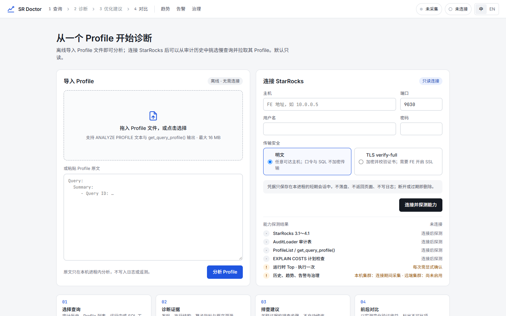<br><sub><b>首次进入</b>：离线导入 Profile，或只读连接 StarRocks</sub></td>
    <td width="50%">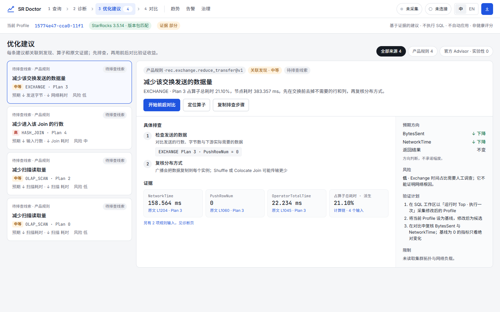<br><sub><b>优化建议</b>：关联发现项、算子与原文证据</sub></td>
  </tr>
  <tr>
    <td>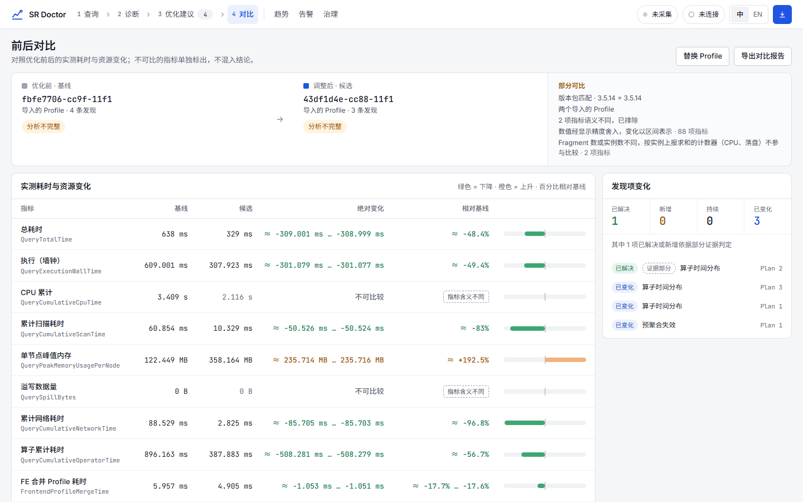<br><sub><b>前后对比</b>：实测区间、发现项变化与不可比较项</sub></td>
    <td>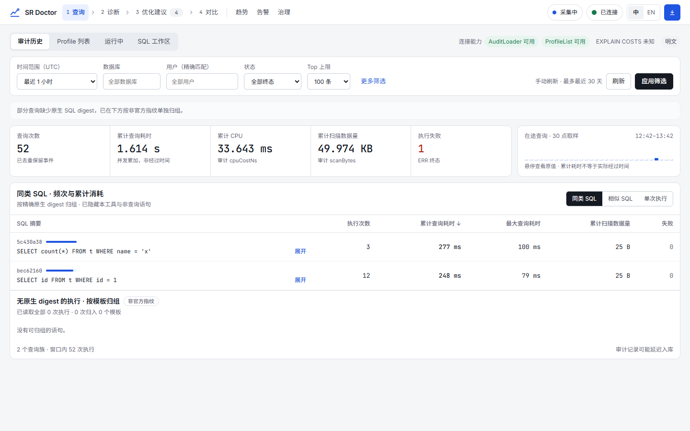<br><sub><b>审计历史</b>：按官方 digest 归并的同类 SQL</sub></td>
  </tr>
  <tr>
    <td>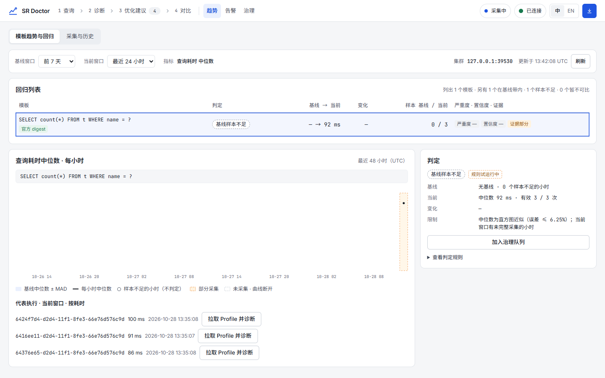<br><sub><b>模板趋势</b>：每小时中位数与基线带</sub></td>
    <td>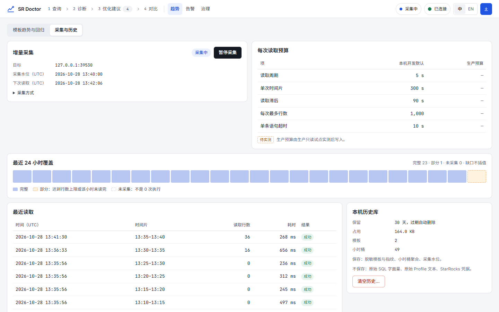<br><sub><b>采集与历史</b>：水位、读取预算与覆盖率</sub></td>
  </tr>
  <tr>
    <td colspan="2">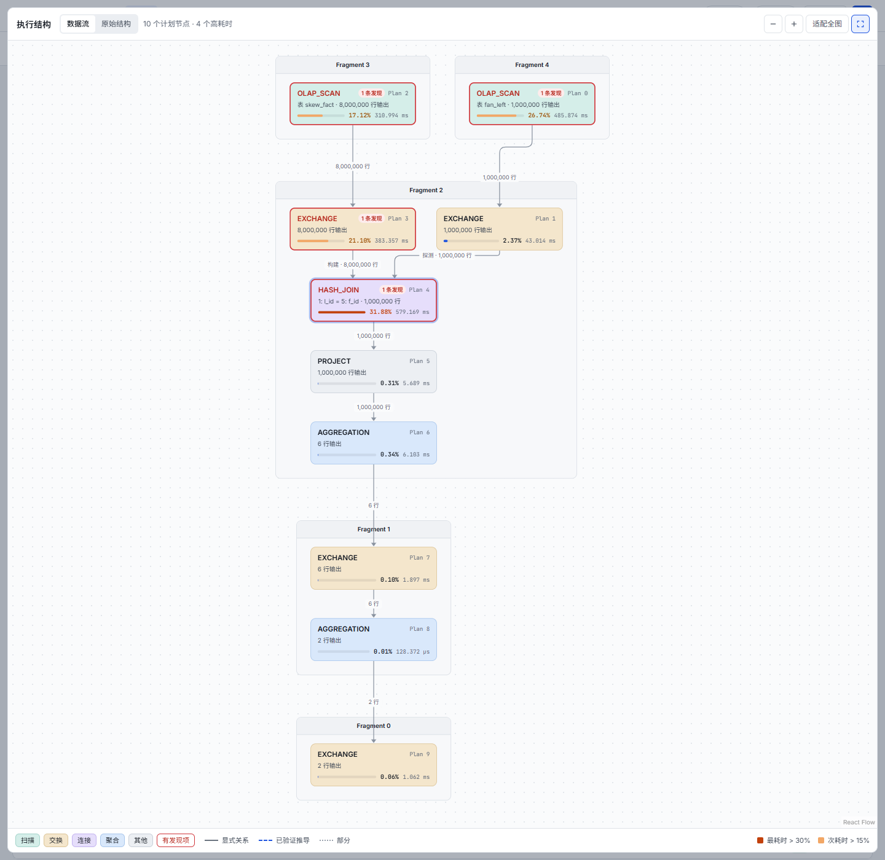<br><sub><b>执行结构</b>：Fragment 容器、算子类别配色、有发现项的节点红框标出，连线上是上游输出行数与 Join 的探测/构建输入</sub></td>
  </tr>
  <tr>
    <td>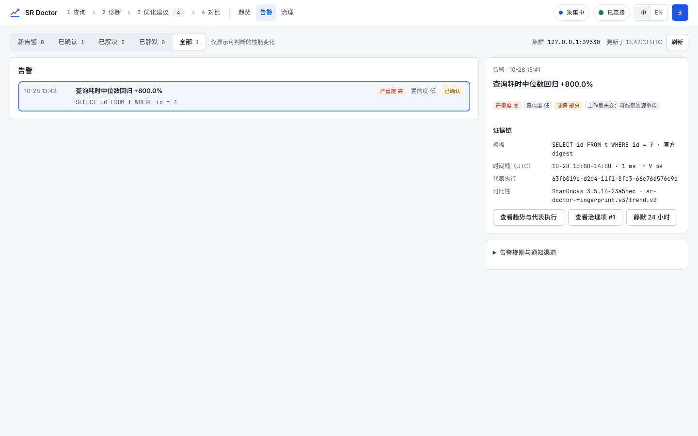<br><sub><b>告警</b>：回归判定与证据链</sub></td>
    <td>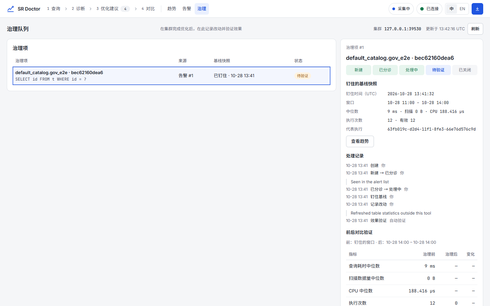<br><sub><b>治理队列</b>：钉住基线，验证后关闭</sub></td>
  </tr>
</table>

<sub>截图来自真实运行的本产品：离线页面使用仓库内的官方 3.5.14 语料；连接与监控页面连接本机 Docker 3.5.14 夹具，数据来自真实采集的测试负载，加一段标明为合成的历史基线。均非生产数据。</sub>

## 工作方式

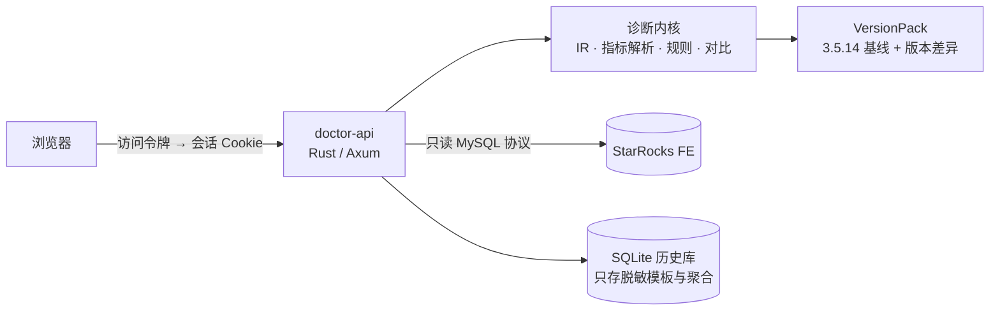

一个进程同时提供页面与 API；前端只渲染后端给出的结果，不自行解析 Profile 或重算指标。详见 [架构概览](docs/development/architecture.md)。

## 安全与边界

- **连接只读**：不执行 DDL/DML、多语句或 `EXPLAIN ANALYZE`，不自动修改 SQL 或参数。
- **凭据不落盘**：StarRocks 口令只保存在服务进程内存的短期会话里，不返回前端，不写日志。
- **历史库脱敏**：只存脱敏模板、指纹与小时聚合，默认保留 30 天；不存 SQL 字面量、Profile 原文或口令。
- **访问控制**：服务器部署必须配置访问令牌，否则拒绝启动；写请求还要求同源与 CSRF 校验。所有使用者共用一个令牌，没有账号与权限区分。
- **传输**：默认明文，可连接任意可达主机，界面会明确标注；FE 开启 SSL 时可选 TLS verify-full。

完整的安全模型与漏洞报告方式见 [SECURITY.md](SECURITY.md)。

## 支持的 StarRocks 版本

从 **3.1** 开始，往后的版本线都支持；目前已审计到 4.1。规则只有一套（3.5.14 基线），其他版本的差异来自对官方源码的逐版本审计，每条版本线都在官方镜像上逐节点对照过官方 `ANALYZE PROFILE`。

| 版本线 | 状态 | 说明 |
|---|---|---|
| 3.1（3.1.0～3.1.17） | ✅ 支持 | 没有 Plan Advisor；3.1.0～3.1.3 的早期写法（计数格式、无编号算子、输出行取法、缺失的查询指标）已按官方源码适配 |
| 3.2（3.2.0～3.2.16） | ✅ 支持 | 没有 Plan Advisor；3.2.9 及以前缺少部分查询级内存指标，显示为不可用 |
| 3.3（3.3.0～3.3.22） | ✅ 支持 | 没有 Plan Advisor；3.3.0～3.3.11 的官方合并缺陷会把最大值算错，这些版本不使用 `__MAX_OF_` 作为证据 |
| 3.4（3.4.0～3.4.10） | ✅ 支持 | 3.4.0～3.4.1 同样有合并缺陷 |
| 3.5（3.5.0～3.5.21） | ✅ 支持 | 语义基线 3.5.14 在这条线上 |
| 4.0（4.0.0～4.0.17） | ✅ 支持 | 4.0.17 的查询级 CPU 与溢写改为按 BE 取最大再求和，已适配 |
| 4.1（4.1.0～4.1.7） | ✅ 支持 | 同上（4.1.7） |
| 新版本线（4.2 起）与已支持线更新的补丁 | ⏳ 审计后支持 | 先做源码审计和官方镜像冒烟，再登记为支持；在此之前不套用最近版本的规则，指标显示为不可用 |
| 2.5、3.0 | ❌ 不支持 | 原因见下 |

**为什么不再支持 2.5 和 3.0：**

- **没有官方语义可依**：官方的算子耗时占比与输出行数算法（`ExplainAnalyzer`）从 3.1 才有。2.5、3.0 的 Profile 也不输出拓扑，没有最终快照和合并状态的标记。要给出执行图、耗时占比和健康结论，只能由我们自己推导，而且没有官方 `ANALYZE PROFILE` 可以对照、无法验证。这违背本项目“只按官方语义解析、缺失就说缺失”的原则。
- **官方早已停止维护**：3.0 的最后一个补丁是 3.0.9（2023-12），2.5 是 2.5.22（2024-06）。
- **成本与收益不成比例**：这两版的 Profile 文本结构（执行段标题、查询状态写法、无编号的算子）与 3.1 起都不同，需要单独维护一套解析分支，换来的却是给不出结论的读取。

连接 2.5、3.0 时会提示“不支持的版本”，不拉取审计和 Profile；导入它们的 Profile 时标为不支持的版本，指标一律不可用，不给数字结论。3.1～3.4 虽然官方也已不再维护，但它们带有官方语义并已逐节点验证，所以继续支持。

## 项目状态

| | 状态 |
|---|---|
| 最近发布 | v1.0 开发版（`main`）。v1.0 起服务器部署统一用 Docker |
| `main`（v1.0） | SQL 质量监控阶段 A～D 已完成开发与本机验收；全项目审计的 19 个问题已修复 |
| 本机验证 | 本地 CI 全部通过；固定 digest 的官方 `starrocks/*:3.5.14` Docker 夹具上，指纹、采集、趋势、告警治理、多 BE、发布级审计、TLS verify-full 的 E2E 均通过 |
| 生产验收 | **待验证**：G1 生产只读试点、G2 真实业务分布校准尚未进行。因此不宣称 Production-safe；远端集群默认不采集，告警阈值标为“规则试运行中” |
| 支持版本 | StarRocks **3.1 及以后**（已审计 3.1～4.1），2.5、3.0 不支持；详见[支持的 StarRocks 版本](#支持的-starrocks-版本) |

后续计划（多用户与权限、外发通知等）不在 v1.0 范围内。

## 文档

| 我想… | 看这里 |
|---|---|
| 5 分钟跑起来 | [快速开始](docs/guide/quick-start.md) |
| 部署到服务器、离线安装、配 HTTPS | [部署指南](docs/guide/deployment.md) |
| 查所有配置项 | [配置参考](docs/guide/configuration.md) |
| 学会各个页面怎么用 | [使用指南](docs/guide/user-guide.md) |
| 解决常见问题 | [常见问题](docs/guide/faq.md) |
| 本地开发、跑测试 | [开发指南](docs/development/README.md) · [参与开发](CONTRIBUTING.md) |
| 了解设计与契约 | [文档中心](docs/README.md) |

## 参与开发

欢迎提 Issue 和 PR。开始之前请阅读 [CONTRIBUTING.md](CONTRIBUTING.md)：仓库使用本机 CI（`scripts/ci/local-ci.ps1`），提交前需全部通过；涉及解析器、执行结构、安全边界的改动必须带测试。

## 致谢与 clean-room 声明

UI 的信息架构参考过社区 Profile 工具的可见交互习惯（见 [产品边界与基线策略](docs/00-product-scope-and-baselines.md#22-社区工具只观察可见行为)）。代码、解析器、规则与阈值均为自研，以 StarRocks 3.5.14 官方源码与文档为语义基准；仓库不包含参考项目的源码、截图或品牌资产。StarRocks 是其各自所有者的商标。

## 商标

StarRocks 是 StarRocks 项目（a Series of LF Projects, LLC）的商标，相关政策见 [lfprojects.org/policies](https://lfprojects.org/policies/)。SR Doctor 是独立开发的非官方工具，与 StarRocks 项目、LF Projects, LLC 及 Linux 基金会均无隶属、赞助或背书关系；名称中的“for StarRocks”只表示它面向 StarRocks 使用。

## 许可证

[Apache License 2.0](LICENSE)，另见 [NOTICE](NOTICE)。
