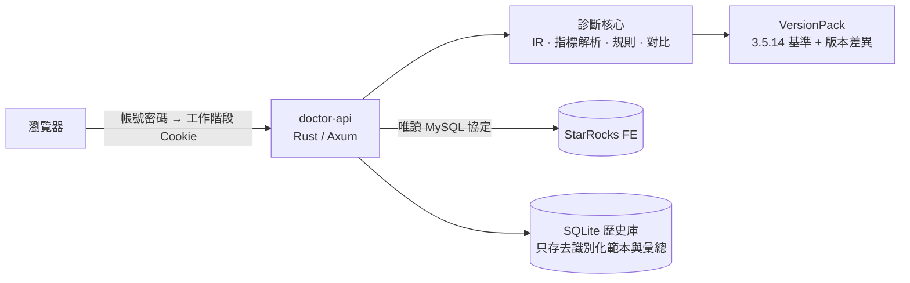

<div align="center">

# SR Doctor for StarRocks

[简体中文](README.md) · [English](README.en.md) · **繁體中文**

**StarRocks 查詢 Profile 診斷與 SQL 品質監控工作台**

<sub>獨立的社群工具，非 StarRocks 官方產品，與 StarRocks 專案無隸屬或背書關係。StarRocks 是其專案所有者的商標，詳見[商標](#商標)。</sub>

看清一條慢 SQL 的時間花在哪裡、為什麼，並持續發現哪些 SQL 正在變慢。<br>
每一個結論都附證據；證據不夠時，它會直說「不知道」。

[](LICENSE)
[](docs/guide/faq.md)
[](docs/development/architecture.md)
[](docs/development/architecture.md)
[](#專案狀態)

[快速開始](#快速開始) · [功能](#功能) · [截圖](#截圖) · [文件](#文件) · [安全](SECURITY.md) · [參與開發](CONTRIBUTING.md) · [更新日誌](CHANGELOG.md)


</div>

> 產品介面支援簡體中文與英文；`docs/` 下的詳細指南以簡體中文撰寫。

## 為什麼用它

StarRocks 的 Query Profile 資訊量很大：幾十個 Fragment、上百個運算子、成千個指標。要從裡面讀出結論，往往得靠經驗，讀出來的結論也很難複核。本專案把這件事做成一個**有證據、可複核**的工作台：

- **只按官方語義解析**：指標單位、運算子合併、時間佔比，都以 StarRocks 官方原始碼為準，不靠猜。支援 3.1 及以後的版本：一套 3.5.14 基準規則，加上逐版本稽核官方原始碼得出的差異。
- **每個結論都能追溯**：發現項附帶證據、信賴度、限制說明和原始 Profile 位置；執行結構只畫能證明的邊。
- **缺失就說缺失**：資料缺失、解析失敗、樣本不足、版本不可比，都會如實標出，不當成 `0`，也不硬給結論。
- **預設唯讀，部署簡單**：一條命令部署到 Linux 伺服器，團隊成員用瀏覽器存取；連線 StarRocks 只填 IP、連接埠、使用者名稱和密碼。

## 快速開始

在一台裝有 Docker 與 Compose 的 Linux 伺服器上：

```bash
git clone https://github.com/shenhui027-arch/sr-doctor.git
cd sr-doctor
docker compose up -d --build
```

然後：

1. 瀏覽器開啟 `http://<伺服器位址>:8000`，用預設帳號 `admin` / `123456` 登入（改密碼：在 `.env` 寫 `DOCTOR_ADMIN_PASSWORD=新密碼` 後重新 `docker compose up -d`）；
2. 點右上角 **連線**，填寫 StarRocks FE 的 IP、連接埠（預設 `9030`）、使用者名稱、密碼；
3. 在 **查詢** 裡選一筆稽核記錄或 Profile，查看診斷。

沒有 StarRocks 叢集也能用：在首頁 **匯入 Profile**，離線分析 JSON 或文字 Profile。

> 需要狀態、備份、升級等維運指令時，可以用包裝同一個 `compose.yaml` 的 `./deploy.sh`。伺服器無法連外時，在能連網的機器上執行 `./deploy.sh package` 打出離線安裝包，複製到伺服器解壓後執行 `./deploy.sh` 即可。其他部署方式（本機程序、SSH 通道、HTTPS 反向代理）見[部署指南（簡體中文）](docs/guide/deployment.md)。

## 功能

### Profile 診斷

| 能力 | 說明 |
|---|---|
| 匯入與拉取 | 離線匯入 JSON/文字 Profile；或唯讀連線 StarRocks，從稽核歷史、Profile 清單、執行中查詢拉取 |
| 真實執行結構 | Fragment 與運算子拓撲，區分明確、已驗證推導與部分關係，不偽造邊 |
| 發現項 | 依嚴重度排列，每條附證據、信賴度、限制說明與最佳化建議；不輸出健康分數 |
| 運算子與指標 | 全部指標經唯一的 Typed Metric Parser 解析，原始 Profile 與溯源隨時可查 |
| 最佳化建議 | 每條建議關聯發現項、運算子與原文證據，給出排查步驟與驗證計畫；不自動修改 SQL |
| 前後對比 | 實測變化以區間表示；基準為 0 只給絕對變化；語義不同標「不可比較」 |
| SQL 工作區 | 固定的 `EXPLAIN COSTS` 拓撲；明確開啟「執行時 Top」後，可執行一條受限的 `SELECT`/`WITH` 並分析其 Profile |
| 匯出 | 去識別化的分析報告與對比報告 |

### SQL 品質監控（v1.0）

| 能力 | 說明 |
|---|---|
| 指紋與分群 | 優先沿用官方 digest；缺失時使用正規化指紋並標「非官方」；相似分群顯示合併依據，可拆分 |
| 歷史與採集 | 連線期間有界增量採集稽核日誌：單一連線、固定週期、限制列數與逾時；超出預算寧可漏採並標「部分」 |
| 趨勢與回歸 | 每小時中位數與基準帶；樣本不足、版本或規則變化、採集缺口都如實標註，不內插 |
| 應用內告警 | 只來自回歸判定，分開呈現嚴重度、信賴度與證據完整度 |
| 治理佇列 | 新建 → 已分類 → 處理中 → 待驗證 → 已關閉；只有前後對比驗證確認改善才會關閉 |

## 截圖

<table>
  <tr>
    <td width="50%"><br><sub><b>首次進入</b>：離線匯入 Profile，或唯讀連線 StarRocks</sub></td>
    <td width="50%"><br><sub><b>最佳化建議</b>：關聯發現項、運算子與原文證據</sub></td>
  </tr>
  <tr>
    <td><br><sub><b>前後對比</b>：實測區間、發現項變化與不可比較項</sub></td>
    <td><br><sub><b>稽核歷史</b>：依官方 digest 合併的同類 SQL</sub></td>
  </tr>
  <tr>
    <td colspan="2"><br><sub><b>執行結構</b>：Fragment 容器、運算子類別配色、有發現項的節點以紅框標出，連線上是上游輸出列數與 Join 的探測／建置輸入</sub></td>
  </tr>
  <tr>
    <td><br><sub><b>範本趨勢</b>：每小時中位數與基準帶</sub></td>
    <td><br><sub><b>採集與歷史</b>：水位、讀取預算與覆蓋率</sub></td>
  </tr>
  <tr>
    <td><br><sub><b>告警</b>：回歸判定與證據鏈</sub></td>
    <td><br><sub><b>治理佇列</b>：釘選基準，驗證後關閉</sub></td>
  </tr>
</table>

<sub>截圖來自實際執行的本產品（介面為簡體中文）：離線頁面使用倉庫內的官方 3.5.14 語料；連線與監控頁面連線本機 Docker 3.5.14 測試環境，資料來自真實採集的測試負載，加上一段標明為合成的歷史基準。均非正式環境資料。</sub>

## 運作方式



一個程序同時提供頁面與 API；前端只呈現後端給出的結果，不自行解析 Profile 或重算指標。詳見[架構概覽（簡體中文）](docs/development/architecture.md)。

## 安全與邊界

- **連線唯讀**：不執行 DDL/DML、多語句或 `EXPLAIN ANALYZE`，不自動修改 SQL 或參數。
- **憑證不落地**：StarRocks 密碼只保存在服務程序記憶體的短期工作階段裡，不回傳前端，不寫入日誌。
- **歷史庫去識別化**：只存去識別化範本、指紋與每小時彙總，預設保留 30 天；不存 SQL 常值、Profile 原文或密碼。
- **存取控制**：伺服器部署要求登入，預設帳號 `admin` / `123456`，可在 `.env` 中修改；寫入請求還要求同源與 CSRF 驗證。所有使用者共用一個帳號，沒有權限區分。預設密碼人人都知道，服務暴露在不完全可信的網路時請先改密碼。
- **傳輸**：預設明文，可連線任意可達主機，介面會明確標示；FE 開啟 SSL 時可選 TLS verify-full。

完整的安全模型與漏洞回報方式見 [SECURITY.md](SECURITY.md)。

## 支援的 StarRocks 版本

從 **3.1** 開始，往後的版本線都支援；目前已稽核到 4.1。規則只有一套（3.5.14 基準），其他版本的差異來自對官方原始碼的逐版本稽核，每條版本線都在官方映像上逐節點對照過官方 `ANALYZE PROFILE`。

| 版本線 | 狀態 | 說明 |
|---|---|---|
| 3.1（3.1.0～3.1.17） | ✅ 支援 | 沒有 Plan Advisor；3.1.0～3.1.3 的早期寫法（計數格式、無編號運算子、輸出列取法、缺少的查詢指標）已按官方原始碼適配 |
| 3.2（3.2.0～3.2.16） | ✅ 支援 | 沒有 Plan Advisor；3.2.9 及以前缺少部分查詢級記憶體指標，顯示為不可用 |
| 3.3（3.3.0～3.3.22） | ✅ 支援 | 沒有 Plan Advisor；3.3.0～3.3.11 的官方合併缺陷會把最大值算錯，這些版本不使用 `__MAX_OF_` 作為證據 |
| 3.4（3.4.0～3.4.10） | ✅ 支援 | 3.4.0～3.4.1 同樣有合併缺陷 |
| 3.5（3.5.0～3.5.21） | ✅ 支援 | 語義基準 3.5.14 在這條線上 |
| 4.0（4.0.0～4.0.17） | ✅ 支援 | 4.0.17 的查詢級 CPU 與溢寫改為按 BE 取最大再加總，已適配 |
| 4.1（4.1.0～4.1.7） | ✅ 支援 | 同上（4.1.7） |
| 新版本線（4.2 起）與已支援線更新的修補 | ⏳ 稽核後支援 | 先做原始碼稽核與官方映像冒煙，再登記為支援；在此之前不套用最近版本的規則，指標顯示為不可用 |
| 2.5、3.0 | ❌ 不支援 | 原因見下 |

**為什麼不再支援 2.5 與 3.0：**

- **沒有官方語義可依**：官方的運算子耗時佔比與輸出列數演算法（`ExplainAnalyzer`）從 3.1 才有。2.5、3.0 的 Profile 也不輸出拓撲，沒有最終快照與合併狀態的標記。要給出執行圖、耗時佔比與健康結論，只能由我們自行推導，而且沒有官方 `ANALYZE PROFILE` 可以對照、無法驗證。這違背本專案「只按官方語義解析、缺少就說缺少」的原則。
- **官方早已停止維護**：3.0 的最後一個修補是 3.0.9（2023-12），2.5 是 2.5.22（2024-06）。
- **成本與效益不成比例**：這兩版的 Profile 文字結構（執行段標題、查詢狀態寫法、無編號的運算子）與 3.1 起都不同，需要另外維護一套解析分支，換來的卻是給不出結論的讀取。

連線 2.5、3.0 時會提示「不支援的版本」，不拉取稽核與 Profile；匯入它們的 Profile 時標為不支援的版本，指標一律不可用，不給數字結論。3.1～3.4 雖然官方也已不再維護，但它們帶有官方語義並已逐節點驗證，所以繼續支援。

## 專案狀態

| | 狀態 |
|---|---|
| 最近發布 | **v1.0.0**（2026-10-29），見 [Releases](https://github.com/shenhui027-arch/sr-doctor/releases)。伺服器部署統一使用 Docker，不提供安裝包 |
| v1.0.0 | SQL 品質監控階段 A～D 已完成開發與本機驗收；全專案稽核的 19 個問題已修復 |
| 本機驗證 | 本地 CI 全部通過；固定 digest 的官方 `starrocks/*:3.5.14` Docker 測試環境上，指紋、採集、趨勢、告警治理、多 BE、發布級稽核、TLS verify-full 的 E2E 均通過 |
| 正式環境驗收 | **待驗證**：G1 正式環境唯讀試點、G2 真實業務分布校準尚未進行。因此不宣稱 Production-safe；遠端叢集預設不採集，告警門檻標為「規則試行中」 |
| 支援版本 | StarRocks **3.1 及以後**（已稽核 3.1～4.1），2.5、3.0 不支援；詳見[支援的 StarRocks 版本](#支援的-starrocks-版本) |

後續計畫（多使用者與權限、對外通知等）不在 v1.0 範圍內。

## 文件

以下指南以簡體中文撰寫。

| 我想… | 看這裡 |
|---|---|
| 5 分鐘跑起來 | [快速開始](docs/guide/quick-start.md) |
| 部署到伺服器、離線安裝、設定 HTTPS | [部署指南](docs/guide/deployment.md) |
| 查所有設定項 | [設定參考](docs/guide/configuration.md) |
| 學會各個頁面怎麼用 | [使用指南](docs/guide/user-guide.md) |
| 解決常見問題 | [常見問題](docs/guide/faq.md) |
| 本地開發、跑測試 | [開發指南](docs/development/README.md) · [參與開發](CONTRIBUTING.md) |
| 了解設計與契約 | [文件中心](docs/README.md) |

## 參與開發

歡迎提 Issue 和 PR。開始之前請閱讀 [CONTRIBUTING.md](CONTRIBUTING.md)：倉庫使用本機 CI（`scripts/ci/local-ci.ps1`），合併前需全部通過；涉及解析器、執行結構、安全邊界的修改必須附測試。

## 致謝與 clean-room 聲明

UI 的資訊架構參考過社群 Profile 工具的可見互動習慣（見 [產品邊界與基線策略（簡體中文）](docs/00-product-scope-and-baselines.md#22-社区工具只观察可见行为)）。程式碼、解析器、規則與門檻均為自研，以 StarRocks 3.5.14 官方原始碼與文件為語義基準；倉庫不包含參考專案的原始碼、截圖或品牌資產。StarRocks 是其各自所有者的商標。

## 商標

StarRocks 是 StarRocks 專案（a Series of LF Projects, LLC）的商標，相關政策見 [lfprojects.org/policies](https://lfprojects.org/policies/)。SR Doctor 是獨立開發的非官方工具，與 StarRocks 專案、LF Projects, LLC 及 Linux 基金會均無隸屬、贊助或背書關係；名稱中的「for StarRocks」只表示它面向 StarRocks 使用。

## 授權

[Apache License 2.0](LICENSE)，另見 [NOTICE](NOTICE)。
