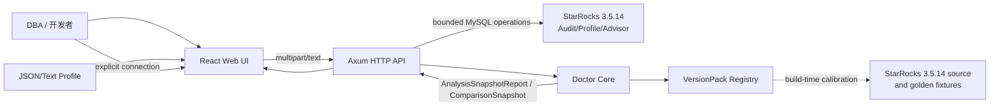

# SR Doctor v0.1 目标架构

状态：Approved architecture baseline / 实现：已实现，随 v0.7.0 冻结
官方校准：`StarRocks 3.5.14@23a56ec517db763ea9bc7ee50b19357acdee0303`

## 1. 架构目标与不变量

1. 官方 3.5.14 源码是构建期语义 oracle；连接目标 StarRocks FE 是可选运行时 evidence source，不把 FE planner 嵌入产品。
2. JSON/Text Profile 先进入统一后端内核，前端只消费规范化 DTO。
3. 所有数值只经一个 Strict Typed Metric Parser。
4. 缺失、非法、部分、溢出、未知版本与真实 0 必须可区分。
5. 拓扑只能是 explicit、唯一可证的 derived、partial 或 unavailable；不伪造关系。
6. Finding 是带 evidence/confidence/limitations/rule trace 的可回放结论，不是简单阈值文案。
7. v0.1 不建立总体健康分，不将 latency 等同于 health。
8. Offline 无集群时仍可完成分析；Connected 模式通过短期最小权限会话完成 Audit/Profile/Explain/Compare，产品不执行用户 SQL，无产品数据库或外部分享服务。

## 2. 系统上下文



信任边界：

- Profile、SQL、节点名、metadata、连接地址和 StarRocks 响应都不受信。
- 原生模式 TCP peer 必须是 loopback；显式容器模式只接受 Docker bridge 所需的 private/link-local/loopback peer，且宿主 Compose 只发布到 Windows loopback。HTTP `Host` 和浏览器 `Origin` 必须命中允许清单；浏览器写请求还必须携带由 `/api/v1/capabilities` 发放的进程级 CSRF nonce。
- API 必须在解析前执行字节、行长、嵌套深度、节点数、超时和同时任务预算。
- 原文不写入日志、trace 和 telemetry；错误响应不回显完整原文或内部栈。
- React 通过 text/DOM API 渲染，不使用 Profile 字段生成 HTML。
- StarRocks password 是 write-only secret，仅驻留进程内短期会话；禁 multi-statements，远端必须 TLS verify-full，明文只允许 loopback 一次性 Docker。
- Connected 默认 Browse；Plan 只执行普通 EXPLAIN；`EXPLAIN ANALYZE`、Execute/Mutate 在 v0.1 全部禁止。

## 3. 部署单元

```text
browser
  -> frontend static assets
  -> /api/v1/*
single local process
  -> Axum router
  -> doctor-core library
  -> version-pack-3_5_14
  -> bounded StarRocks connector pool (max 3, idle TTL)
```

- 开发时：Vite dev server 代理到 Axum；dev Host/Origin 必须显式配置，不以 wildcard 放开。
- Candidate 时：Axum 可直接服务前端静态产物；原生 Candidate 和 Docker Desktop 都只支持同一 Windows 主机访问，不是生产部署承诺。
- 原生进程默认 bind `127.0.0.1`。只有显式 `loopback-published` 容器模式在容器网络命名空间内监听 wildcard，并由受控 Compose 固定发布到 Windows `127.0.0.1`；不提供 LAN/public bind 开关。
- 分析结果随响应返回，不保存分析任务；仅连接凭据保存在最多三个短期 opaque connection session，默认 idle 15 分钟，关闭/过期即删除。

## 4. 后端模块边界

```text
backend/
  crates/
    doctor-contracts/      # DTO/schema 与稳定枚举
    doctor-core/           # 无 Web 框架的纯领域库
      input/
      metrics/
      ir/
      graph/
      rules/
      compare/
      provenance/
    doctor-connector/      # MySQL 连接、能力探测、Audit/Profile/Advisor/Explain 与 execute deny gate
    doctor-export/         # 确定性脱敏报告
    version-packs/
      starrocks_3_5_14/     # Cargo package: starrocks-version-pack-3-5-14
    rule-sets/
      doctor_v0_1/           # Cargo package: doctor-rules-v0-1
    doctor-api/            # Axum，只处理 I/O/限制/映射
```

### 4.1 Input Envelope

输入统一包装为 `InputEnvelope`：

- `source_kind`: `json_profile | text_profile | auto`；
- `content`: 原始 bytes/text；
- `version_hint`: `auto | 3.5.14`；
- `filename` 只作 provenance，不参与格式判定；
- `input_hash`: 对内容计算，用于证据回放，不写入原文。

Type Detector 只判断输入 adapter，不将解析失败静默转到另一 adapter。`auto` 必须在 diagnostics 中记录选择理由。

### 4.2 Source Adapters

- JSON Adapter：校验结构、保留未知字段诊断，输出 Partial IR。
- Text Adapter：按 section/indent/key-value grammar 解析，输出 consumed ranges 和 diagnostics。
- Adapter 只做结构识别与原始值提取，不在内部自建 duration/bytes parser。

### 4.3 Typed Metric Parser 与 Registry

Parser 将输入变为内部 `MetricObservation`，Registry 决定指标的 dimension、canonical unit、scope、source Counter strategy、产品 aggregation、aliases、fidelity policy 和 release applicability。规则只接受满足自身 applicability 的 typed observation/bounds；partial/invalid 无 canonical value，有损区间只能按契约形成 suspected/not_applicable，不能伪装 exact。

### 4.4 Normalized IR

后端 `NormalizedIR` 是 parser/graph/rule/compare 的内部领域事实；前端只消费独立的安全 `AnalysisSnapshotReport`。两者不共用 wire struct：

- 内部 IR 保留 fragments/pipelines/operator groups、MetricObservation、CounterStrategy、merge recipe 和 raw indexes；
- Report 只保留 schema/algorithm/registry/rule/version-pack receipt、input/version/profile context/completeness、query summary；
- Operators 使用 backend formatted MetricCell 与 order_rank；
- graph 使用安全 GraphView + quality/unresolved state；
- findings/evidence/limitations/traces、唯一 diagnostics/provenance 与 sanitized SourceView；
- public Outcome 不复制 analysis state/diagnostics，唯一真值在 Report。

### 4.5 Graph Resolver

解析优先级：

1. 输入中显式 node/edge/root；
2. 可以通过 plan node ID、fragment exchange/sink 和唯一关系证明的 derived edge；
3. 其他节点留在 unconnected/partial；
4. 不存在真实边时返回 unavailable graph，而不是按文本顺序串起来。

node 只带 `source_refs[] + source_quality`；edge 只允许 `source=explicit|verified_derived`、`quality`、证据、可选 versioned derivation recipe，并保存有证据的 source ordinal/input role。Graph 不提供模糊 confidence 或 inferred edge。

### 4.6 Rule Engine

规则包不读原始字符串，只读 typed IR。每条规则包含：

- applicability：version/operator/所需字段/图质量；
- typed inputs 和阈值来源；
- finding severity 与 confidence；
- evidence 和反证；
- limitations/not_applicable 原因；
- recommendation 的风险、验证步骤与非自动执行边界。

### 4.7 Compare

Compare 在两个内部 NormalizedIR/AnalysisOutcome 之间运行，不对原始字符串做 diff；对外只返回安全 `ComparisonSnapshot`。比较分为：

- compatibility/version；
- graph structure；
- normalized metric；
- finding/evidence；
- `not_comparable` 原因。

baseline exact 0 与 bounded baseline interval 含 0 分别返回不同的 percentage undefined state；missing/invalid 不是 0，也不生成伪数值 delta。

### 4.8 Connected Source Adapter

Connector 只负责 I/O 和安全投影，不解析 Profile/Explain 业务语义：

- `current_version()`、AuditLoader allowlisted query、`SHOW PROFILELIST`、`get_query_profile`、`SHOW PLAN ADVISOR`；
- 对单条 SELECT/WITH 请求目标 FE 生成 `EXPLAIN COSTS`；
- 拒绝 `EXPLAIN ANALYZE` 和所有非普通 EXPLAIN 的用户 SQL；candidate Profile 由用户在 StarRocks 侧复跑后拉取；
- 输出 `ConnectedQueryRef`、raw Profile/Explain bytes 和 source receipt，随后交给唯一 Adapter/IR 管线。

`source_kind` 仍只表示 JSON/Text Profile grammar；连接来源由独立 `InputOrigin` 表示。不能因连接方式新增 parser。Audit 不可用时降级到 ProfileList，并保留 unavailable/forbidden，而不是补空 audit 字段。

### 4.9 Explain / Plan Evidence

Explain 使用独立 `ExplainSnapshot`，不伪装 `AnalysisSnapshotReport`。它只保存经 3.5.14 golden 证明的节点、边、operator kind 和登记属性，以及 FE/session/metadata/stats fingerprint 与 source range。Explain/Explain 产出 `PlanComparison`；Profile/Explain 只在 `CorrelationEvidence=verified|partial` 时显示结构关联，runtime delta 固定 unavailable。

### 4.10 Recommendation Orchestrator

Recommendation 汇总两类明确来源：

1. 产品 RuleSet 的 typed Finding/recommendation；
2. StarRocks `SHOW PLAN ADVISOR` 的安全投影。

两类均必须包含 evidence、applicability、limitations、risk、expected direction 与 validation plan。Advisor guide 不改写为产品推理；产品不自动 `ALTER PLAN ADVISOR`、执行 SQL 或应用参数。完整契约见 [连接器与优化验证契约](./11-starrocks-connector-and-optimization-loop.md)。

## 5. VersionPack 与 RuleSet 边界

```rust
trait VersionPack {
    fn identity(&self) -> VersionIdentity;
    fn detect(&self, facts: &DetectionFacts) -> DetectionAssessment;
    fn metric_registry(&self) -> &MetricRegistry;
    fn structural_hints(&self) -> &StructuralHints;
    fn compatibility(&self, facts: &ObservedFacts) -> CompatibilityReport;
}

trait RuleSet {
    fn identity(&self) -> RuleSetIdentity;
    fn compatible_packs(&self) -> &[VersionPackIdentity];
    fn ir_schema_range(&self) -> SchemaRange;
    fn rules(&self) -> &[RuleDefinition];
}
```

这是架构契约伪代码，不冻结 Rust 方法签名。不可变边界是：

- pack 不享有自己的 parser，只配置 detection、alias/grammar allowance、registry、aggregation 和 structural evidence；
- 未注册版本不自动选择最近 pack；
- 用户明确选择 3.5.14 时记录 `version_source=user_declared` 和候选 `pack_match=exact_pack`，不冒充 `detected`，也不直接变成 compatible/supported；
- 每个 pack 固定官方 commit、metric/alias/aggregation delta、structural evidence 和 golden corpus manifest；
- 产品诊断规则属于独立、产品版本化的 RuleSet；RuleSet 显式声明兼容 pack、IR schema 和 applicability，不伪称官方 StarRocks 规则；
- IR 不直接暴露某版本的原始字段布局。

## 6. HTTP API 边界

| Method | Path | 作用 | 状态 |
|---|---|---|---|
| `GET` | `/api/v1/health` | 进程存活，不包含敏感状态 | v0.1 |
| `GET` | `/api/v1/capabilities` | 版本包、输入、限制、算法版本和本进程 CSRF nonce | v0.1 |
| `POST` | `/api/v1/analyses` | 单份 Profile -> `AnalysisOutcome<AnalysisSnapshotReport>` | v0.1 |
| `POST` | `/api/v1/comparisons` | baseline + candidate -> `ComparisonSnapshot` | v0.1 |
| `POST/DELETE` | `/api/v1/connections[/{id}]` | 建立/关闭短期 StarRocks connection session | v0.1 |
| `POST` | `/api/v1/connections/{id}/queries/search` | 有界 Audit/ProfileList 查询 | v0.1 |
| `POST` | `/api/v1/connections/{id}/profiles/fetch` | 按 query ID 拉取并分析 Profile | v0.1 |
| `POST` | `/api/v1/connections/{id}/profiles/compare` | 同一 session 拉取两个已存在 Profile 并后端 Compare；候选只记录用户外部复跑责任 | v0.1 |
| `GET` | `/api/v1/connections/{id}/advisor-guides` | 读取官方 Plan Advisor guide | v0.1 |
| `POST` | `/api/v1/connections/{id}/explain` | 由目标 FE 生成 plan evidence | v0.1 |

API 不提供任意 SQL、DDL/DML/INSERT、自动修改、Plan Advisor mutation、任务持久化、分享 URL 或 Monitor 端点。浏览器写请求必须同时满足 loopback peer、Host/Origin allowlist、严格 Content-Type 和 `X-Doctor-CSRF` nonce。详细 schema 在 Phase 0C 连接增量中冻结。

## 7. 前端信息架构

```text
Header: Product / Connection/Input status (Demo only for mock) / Version / Connect or Import / Theme
Single workspace row:
  Queries | Overview | Findings | Execution | Operators | Source | Recommendations | Compare
```

- 首屏采用单行顶栏加分析上下文栏与高密度宽画布，不改成左侧栏管理后台。
- Overview 展示 input、`version_source`、`pack_match`、`compatibility`、completeness 和事实摘要，不展示总分。
- Findings 展示 severity、confidence、evidence、limitations 和 rule ID。
- Execution 同时显示 graph quality，图不可用时保留诊断而不画假图。
- Operators 只显示 DTO 中的 display/state/fidelity，并按后端 `order_rank` 排序；不可用值显示 em dash 或 Unavailable badge，前端不从 canonical string 重算。
- Source 是只读、安全渲染的原文/溯源视图。
- Queries 显示连接 capability、Audit/ProfileList 来源、digest 和有界查询；不能伪装 live Monitor。
- Recommendations 区分 product rule 与 official Plan Advisor，并提供 controlled change/validation steps。
- Compare 显示 Profile/Profile runtime、Explain/Explain plan-only 或 mixed not-comparable boundary。

## 8. 资源与失败模型

预算具体数值与 HTTP wire 已在 Phase 0C 候选契约固定，错误语义为：

- `invalid_request`：请求格式错；
- `input_too_large | too_deep | too_many_nodes | line_too_long`：安全预算；
- `unsupported_input`：无 adapter；
- `unknown_version | incompatible_version`：能构造事实时为 HTTP 200 Partial Outcome 内的版本状态/diagnostic；
- `partial_analysis`：HTTP 200 + Partial Report；只有完全无法构造可信 Report 才 `parse_failed` 4xx；
- `analysis_timeout`：同步任务资源边界；v0.1 无 public cancelled/任务端点；
- `connection_timeout | tls_failed | authentication_failed | connection_expired`：短期连接；
- `capability_unavailable | audit_table_unavailable | profile_unavailable`：Connected Browse；
- `statement_not_allowed | explain_rejected`：Plan/execute deny gate；
- `internal_error`：稳定错误 ID，不回显内部栈。

Comparison 外层请求合法时保留两侧独立 complete/partial/failed attempt；单侧失败用脱敏 ErrorSummary 和 not_comparable reason，不丢掉另一侧事实。请求级失败使用稳定 ErrorEnvelope。详细见 [HTTP API 契约](./09-http-api-contract.md)。

## 9. 存储与隐私

- 后端不持久化 Profile、SQL、NormalizedIR 或 AnalysisSnapshotReport。
- 后端只在连接 TTL 内保存 credential secret 与 pool；不保存 query history、完整 SQL 或连接配置文件。
- 前端默认只保存当前页内存状态；刷新即清除。
- 用户显式导出报告属于本地下载，不上传第三方；报告导出若不能在 v0.1 闭环内安全完成，则不实现。

## 10. 不在 v0.1 的架构

产品数据库、消息队列、微服务、后台采集、自动聚类、实时 Monitor、任意 SQL 控制台、自动 SQL 改写/执行、用户/RBAC、多租户、云端分享、LLM 诊断、插件平台、HA 和 Kubernetes 都不预建。未来只通过稳定 ConnectedQueryRef/IR/VersionPack/API 边界扩展。

## 11. 架构验收

- 任一前端需求都能从 DTO 满足，不需解析 Profile。
- 任一规则不直接读原始字符串。
- 删除所有参考仓库后，产品仍能构建和测试。
- 新增版本不修改旧 pack 的已有 golden 预期，只通过显式 delta 扩展。
- 无拓扑/缺失 metric/未知版本都能用明确状态完成 UI/API 闭环。
- 官方 3.5.14 Docker + AuditLoader E2E 可重放；Offline lane 不因 Connector 失败而退化。
- 普通 EXPLAIN 之外无用户语句提交，Execute/Mutate 负向测试全部拒绝；Explain 不被表述为 runtime improvement。
