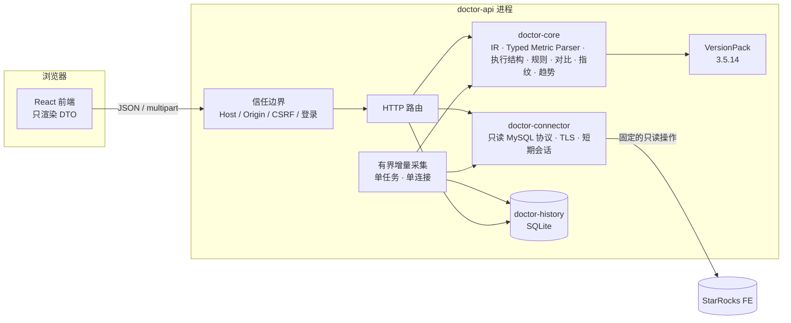

# 架构概览

一个 Rust 进程同时提供网页与 API。前端只渲染后端给出的 DTO；Profile 的解析、指标、规则、执行结构与对比，全部在后端的单一内核中完成。

## 请求路径

1. **信任边界**（`doctor-api`）：校验来源地址、Host、Origin；写请求还要求 JSON/multipart 内容类型与 CSRF 头；网络模式下先校验会话 Cookie。
2. **路由**：离线分析、对比、导出不需要连接；连接相关的路由只调用 `doctor-connector` 中预定义的有界操作。
3. **内核**（`doctor-core`）：把 JSON/文本 Profile 规范化为统一 IR，所有数值经唯一的 Typed Metric Parser，按版本包解释语义，构建执行结构，运行规则，得到带证据的发现项。
4. **契约**（`doctor-contracts`）：内核结果转换为确定性的 DTO，经 ts-rs 导出为前端类型。

## 关键设计

| 设计 | 目的 | 详细文档 |
|---|---|---|
| 统一 IR 与 Typed Metric Parser | 单位、缺失、溢出只在一个地方处理；`missing`/`invalid`/`partial` 与 `0` 可区分 | [统一 IR 与诊断](../02-unified-ir-and-diagnosis.md)、[Metric Parser 契约](../06-metric-parser-contract.md) |
| 执行结构的四种状态 | `explicit`、`derived`、`partial`、`unavailable`，只在唯一可证时推导边 | [统一 IR 与诊断](../02-unified-ir-and-diagnosis.md) |
| VersionPack | 每个 StarRocks 版本独立的语义包，未注册版本不自动套用 | [Fixture、VersionPack 与 RuleSet](../10-fixture-versionpack-and-ruleset-contract.md) |
| 只读连接器 | 显式主机端口、禁用多语句、固定操作、凭据只在内存 | [连接器与优化闭环](../11-starrocks-connector-and-optimization-loop.md) |
| 有界采集 | 单任务、单连接、固定周期与上限；超预算宁可漏采并标“部分” | [配置参考](../guide/configuration.md#历史与采集) |
| 嵌入式 SQLite | 唯一的数据库，只存脱敏模板与聚合 | [部署指南](../guide/deployment.md#数据都在哪里) |
| HTTP 契约与失败语义 | 统一的错误码、阶段与可恢复性 | [HTTP API 契约](../09-http-api-contract.md) |

## 语义基线

唯一的官方语义基线是 StarRocks `3.5.14@23a56ec517db763ea9bc7ee50b19357acdee0303`：`ExplainAnalyzer`、`RuntimeProfile`、`QueryRuntimeProfile` 与 BE `runtime_profile` 的行为是最高优先级证据。官方源码只作为构建期的语义依据与校准来源，不是运行时依赖。基线的采用方法见 [产品边界与基线](../00-product-scope-and-baselines.md) 与 [多基线三角校验协议](../08-comparative-baseline-protocol.md)。

## 部署形态

| 模式 | 监听 | 登录 | 入口 |
|---|---|---|---|
| 回环 | `127.0.0.1` | 不需要 | `cargo run -p doctor-api` |
| Docker 回环发布 | 容器内 `0.0.0.0`，宿主机只发布到 `127.0.0.1` | 不需要 | `deploy/local/compose.yaml` |
| 网络 | 所有网卡或指定地址 | 账号密码（默认 `admin` / `123456`） | 根目录 `compose.yaml`、`deploy.sh` |

见 [部署指南](../guide/deployment.md)。
